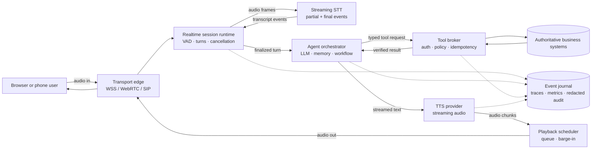
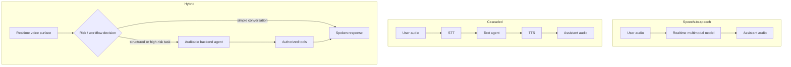
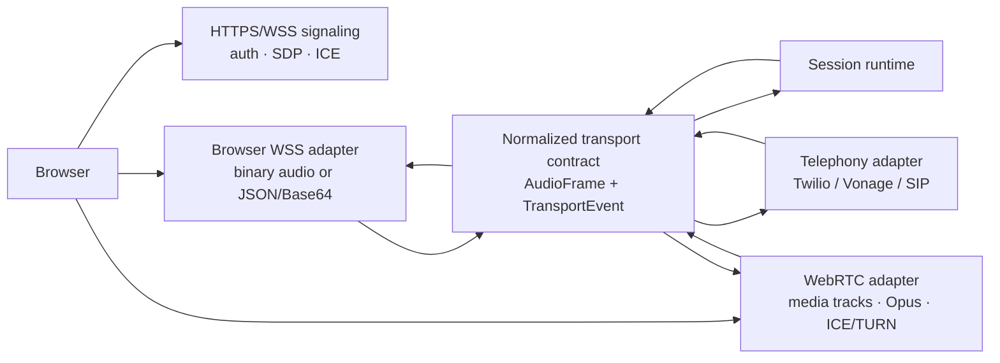
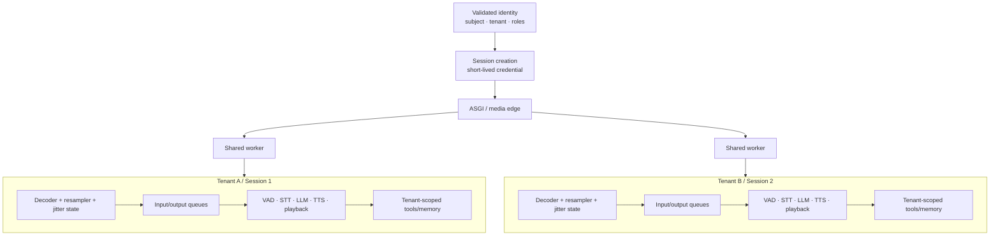
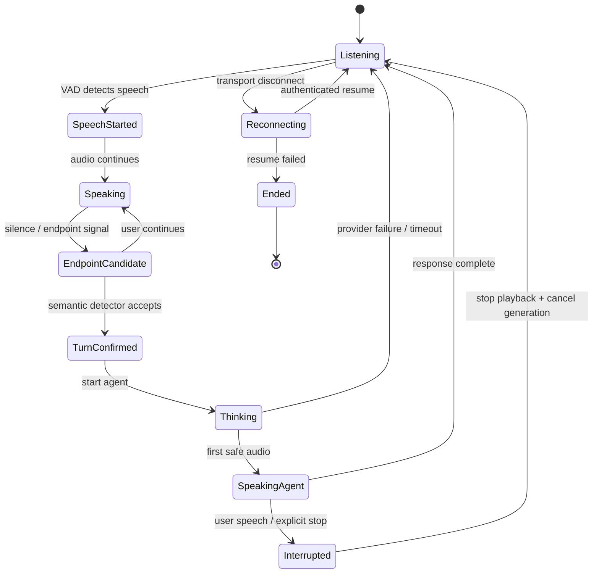
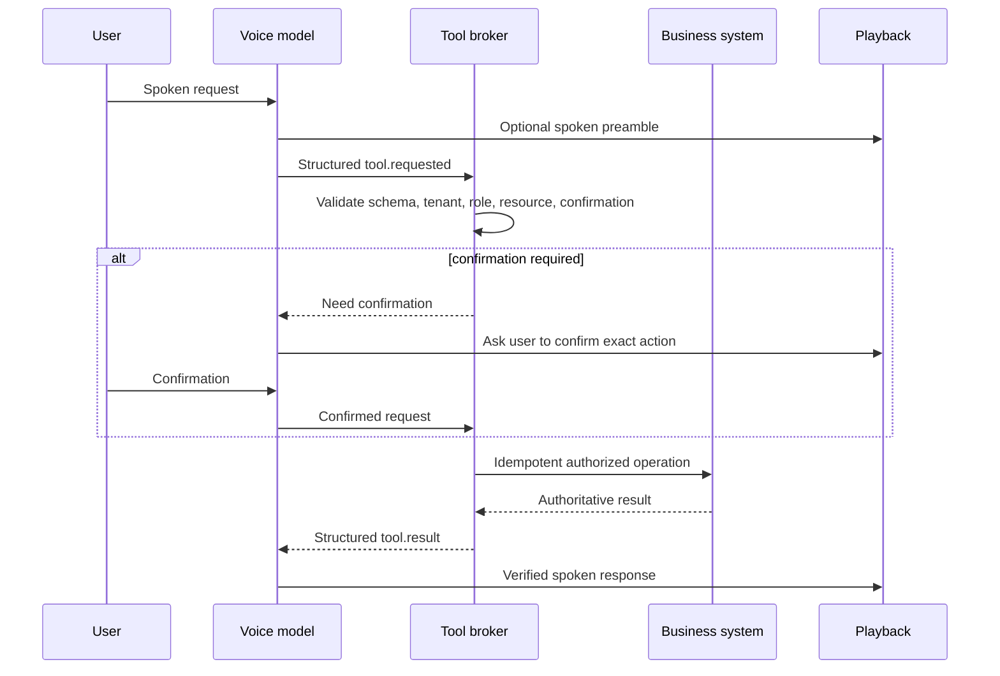
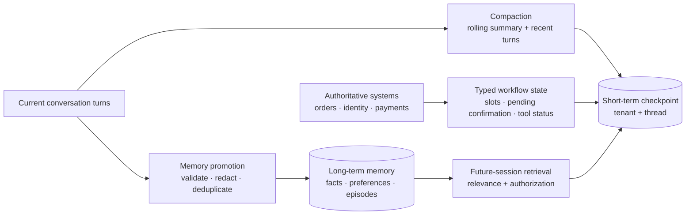
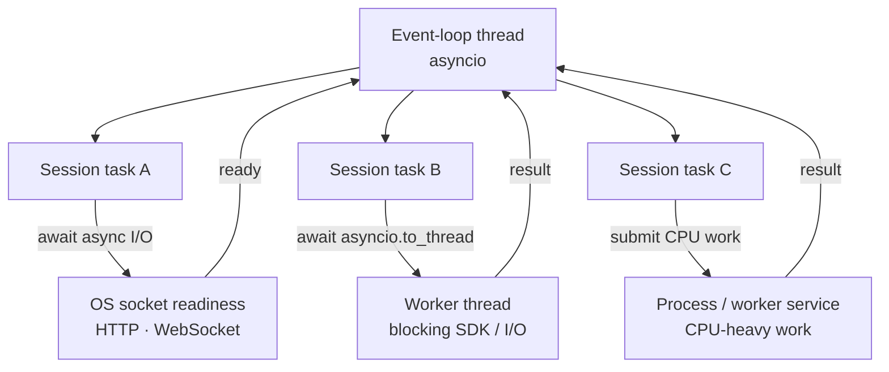

# Voice-agent architecture diagrams

Companion diagrams for the [voice-agent interview preparation guide](./voice-agent-interview.md).
The diagrams are intentionally provider-agnostic; provider names illustrate
integration points, not required choices.

## 1. End-to-end reference architecture



The media path is optimized for low latency. The control path owns
authorization, durable state, tools, and audit evidence. A provider may
collapse several boxes into one managed realtime service, but the ownership
boundaries should remain explicit.

## 2. Cascaded streaming pipeline

```mermaid
flowchart LR
    M[Microphone PCM frames]
    Q1[(Bounded input queue)]
    STT[STT WebSocket]
    TE[Transcript events]
    TURN[Endpointing + semantic turn detection]
    LLM[Text agent / LLM]
    TOK[Streamed text chunks]
    TTS[TTS WebSocket]
    AQ[(Bounded playback queue)]
    SP[Speaker]

    M --> Q1 --> STT
    STT --> TE --> TURN
    TURN -->|turn confirmed| LLM
    LLM --> TOK --> TTS
    TTS --> AQ --> SP
```



The pipeline is incremental:

```text
audio arrives -> partial transcript -> finalized turn
              -> first agent text -> first TTS audio -> playback
```

Partial transcripts can support captions or low-risk speculation. Normal
reasoning and side effects should usually wait for a confirmed turn and pass
through the tool broker.

## 3. Speech-to-speech versus cascaded versus hybrid



| Architecture | Optimize for | Main cost |
| --- | --- | --- |
| Speech-to-speech | Naturalness and low latency | Less intermediate control and provider portability |
| Cascaded | Inspectability, replacement, and policy control | More stages, buffering, and failure boundaries |
| Hybrid | Fast conversation plus controlled high-risk workflows | More orchestration and synchronization |

## 4. Browser transports and provider adapters



The runtime should not depend on provider packet envelopes. Each adapter
authenticates the connection, validates sequence/timestamps and audio format,
then maps provider messages into internal events.

## 5. Multi-tenant session isolation



Shared workers may multiplex I/O, but mutable decoder, VAD, playback,
conversation, and tool state belongs to one `SessionRuntime`. If a provider
multiplexes streams, demultiplex by a trusted provider stream ID, never by
arrival order.

## 6. User turn and barge-in state machine



On interruption, invalidate the response generation, clear queued audio, and
discard late model/TTS events. A committed tool effect is reconciled rather
than pretending it was cancelled.

## 7. Structured tool-call flow



The model proposes. The broker authorizes and executes. The application never
treats arbitrary spoken text as an executable tool call.

## 8. Short-term memory, compaction, and long-term memory



Compaction reduces context size; it does not replace authoritative state.
Long-term memory is promoted explicitly and must retain provenance, scope,
retention, and deletion behavior.

## 9. Python async execution model



`await` suspends the current coroutine at an async operation. A blocking
synchronous call on the event-loop thread stalls every task on that loop.
Threads isolate blocking I/O; processes or services provide CPU parallelism.
