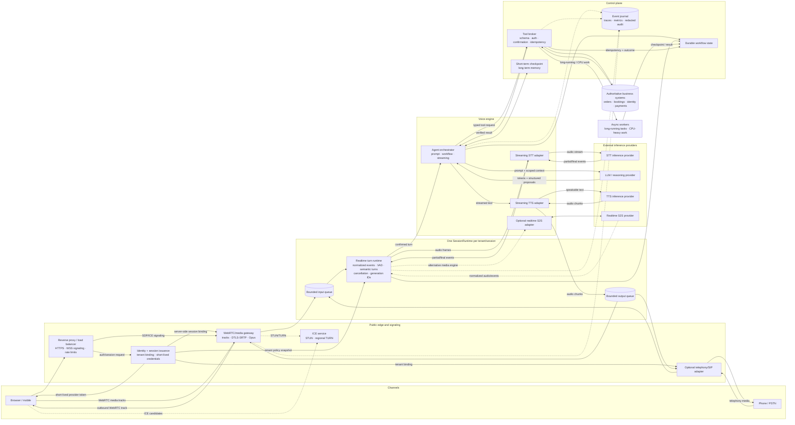
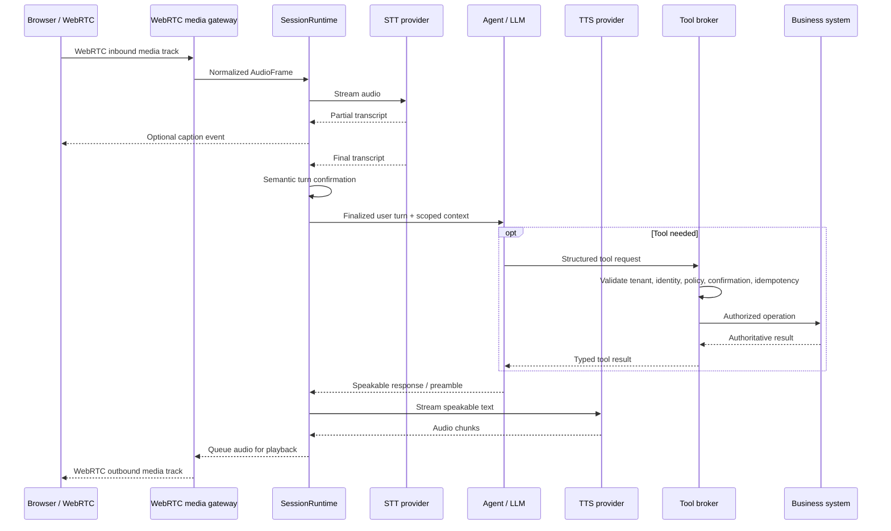
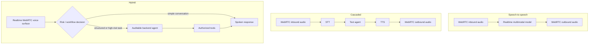
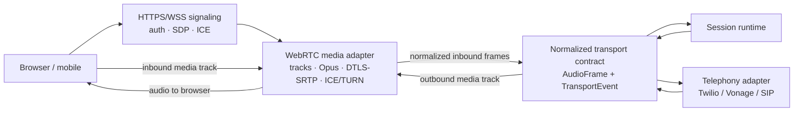
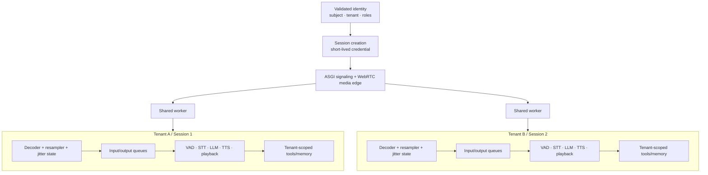
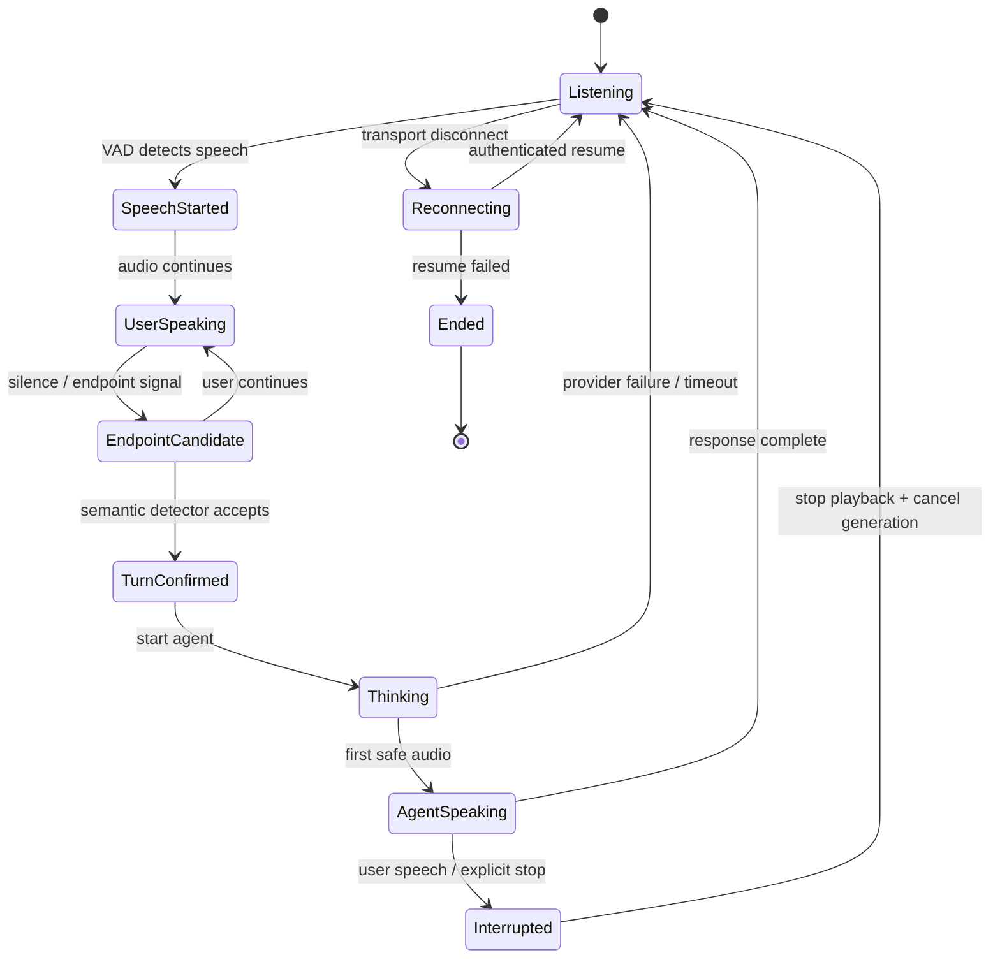
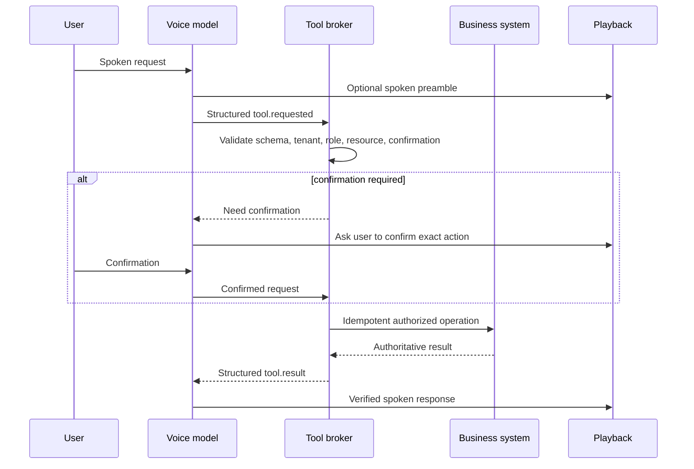
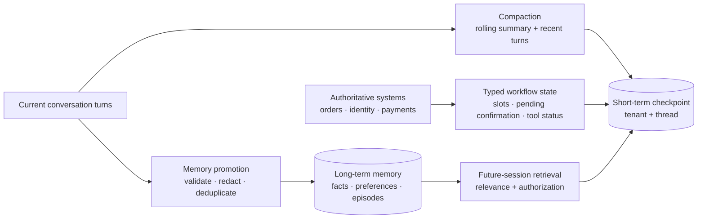
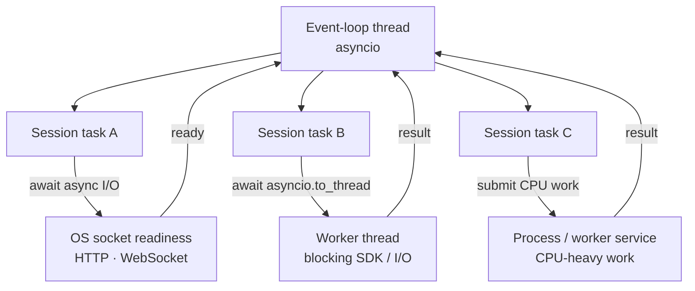

# Voice-agent architecture diagrams

Companion diagrams for the [voice-agent interview preparation guide](./voice-agent-interview.md).
The diagrams are intentionally provider-agnostic; provider names illustrate
integration points, not required choices.

### How to read these diagrams

- Arrows show logical data/control flow; boxes do not necessarily mean separate
  deployable services.
- A dashed arrow is an alternative path or observation/control relationship,
  not an additional mandatory hop.
- The canonical design is a cascaded baseline. A realtime speech-to-speech
  provider can replace the STT/agent/TTS media path, but not the application's
  identity, tenant isolation, tool authority, durable state, or audit boundary.
- Provider adapters translate provider-specific wire messages into normalized
  session events. The `SessionRuntime` owns mutable state for one authenticated
  tenant/session.

## 1. Canonical production/interview architecture



Read the architecture as two cooperating planes:

- **Media plane:** channels, adapters, audio queues, turn detection, model
  streaming, playback, and cancellation. It is time-sensitive and must not
  wait synchronously on slow business operations.
- **Control plane:** identity, tenant policy, tools, confirmations, durable
  workflow state, memory, billing, and audit. It is authoritative and must
  not trust raw audio, transcripts, caller IDs, or model output.

The diagram shows the **cascaded baseline** with WebRTC as the primary browser
media transport:

```text
WebRTC inbound track -> STT -> agent/LLM -> TTS -> WebRTC outbound track
```

The reverse proxy/load balancer handles HTTPS/WSS signaling and public-edge
policy; the WebRTC media track is negotiated through the media gateway and
ICE/TURN path rather than being treated as an ordinary WSS audio stream.

In a managed WebRTC deployment, the `short-lived provider token` is returned
to the browser and presented directly to the managed service. The provider
credential used to mint it and the application-side tenant/session binding
remain server-side. With a self-hosted gateway, the same arrow represents a
server-side credential/session handoff to the gateway instead.

The adapter boxes are application-owned clients and policy boundaries; the
provider boxes are external inference services. The application can replace a
provider without changing the session, tenant, tool, or durable-state
contracts.

For a speech-to-speech design, `S2S` replaces the STT/agent/TTS media path, but
the session runtime, tool broker, durable state, tenant isolation, and
observability boundaries remain.

The most important invariant is:

> One authenticated `SessionRuntime` owns mutable realtime state for exactly
> one tenant/session. Shared workers may multiplex I/O, but must not share
> decoder, VAD, playback, conversation, or tool state across sessions.

## 2. One confirmed turn and tool call



The tool call may occur while audio continues, but the broker—not the model or
browser—owns authorization and side effects. If the user barges in, the
runtime cancels playback/generation where possible and reconciles any tool
operation that has already committed.

## 3. Cascaded streaming pipeline

```mermaid
flowchart LR
    M[WebRTC inbound media track]
    GW[Media gateway<br/>DTLS-SRTP · Opus decode · PCM]
    Q1[(Bounded input queue)]
    STT[STT provider stream]
    TE[Transcript events]
    TURN[Endpointing + semantic turn detection]
    LLM[Text agent / LLM]
    TOK[Streamed text chunks]
    TTS[TTS provider stream]
    AQ[(Bounded playback queue)]
    OUT[WebRTC media gateway<br/>PCM -> Opus outbound track]
    SP[Browser speaker]

    M --> GW --> Q1 --> STT
    STT --> TE --> TURN
    TURN -->|turn confirmed| LLM
    LLM --> TOK --> TTS
    TTS --> AQ --> OUT --> SP
```



The pipeline is incremental:

```text
audio arrives -> partial transcript -> finalized turn
              -> first agent text -> first TTS audio -> playback
```

Partial transcripts can support captions or low-risk speculation. Normal
reasoning and side effects should usually wait for a confirmed turn and pass
through the tool broker. WebRTC is the browser/media transport in this diagram;
the STT and TTS provider streams may use WebSockets or another provider-specific
protocol behind their adapters.

## 4. Speech-to-speech versus cascaded versus hybrid



| Architecture | Optimize for | Main cost |
| --- | --- | --- |
| Speech-to-speech | Naturalness and low latency | Less intermediate control and provider portability |
| Cascaded | Inspectability, replacement, and policy control | More stages, buffering, and failure boundaries |
| Hybrid | Fast conversation plus controlled high-risk workflows | More orchestration and synchronization |

## 5. WebRTC browser transport and provider adapters



WebRTC carries the browser's negotiated media tracks; HTTPS/WSS is used for
authentication and signaling. Telephony remains a separate provider adapter.
The runtime should not depend on provider packet envelopes. Each adapter
authenticates the connection, validates sequence/timestamps and audio format,
then maps provider messages into internal events.

## 6. Multi-tenant session isolation



Shared workers may multiplex I/O, but mutable decoder, VAD, playback,
conversation, and tool state belongs to one `SessionRuntime`. If a provider
multiplexes streams, demultiplex by a trusted provider stream ID, never by
arrival order.

## 7. User turn and barge-in state machine



On interruption, invalidate the response generation, clear queued audio, and
discard late model/TTS events. A committed tool effect is reconciled rather
than pretending it was cancelled.

## 8. Structured tool-call flow



The model proposes. The broker authorizes and executes. The application never
treats arbitrary spoken text as an executable tool call.

## 9. Short-term memory, compaction, and long-term memory



Compaction reduces context size; it does not replace authoritative state.
Long-term memory is promoted explicitly and must retain provenance, scope,
retention, and deletion behavior.

## 10. Python async execution model



`await` suspends the current coroutine at an async operation. A blocking
synchronous call on the event-loop thread stalls every task on that loop.
Threads isolate blocking I/O; processes or services provide CPU parallelism.
