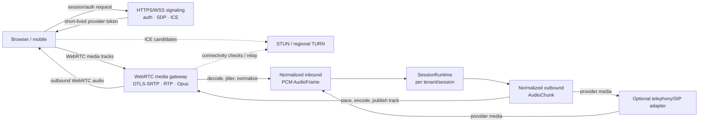
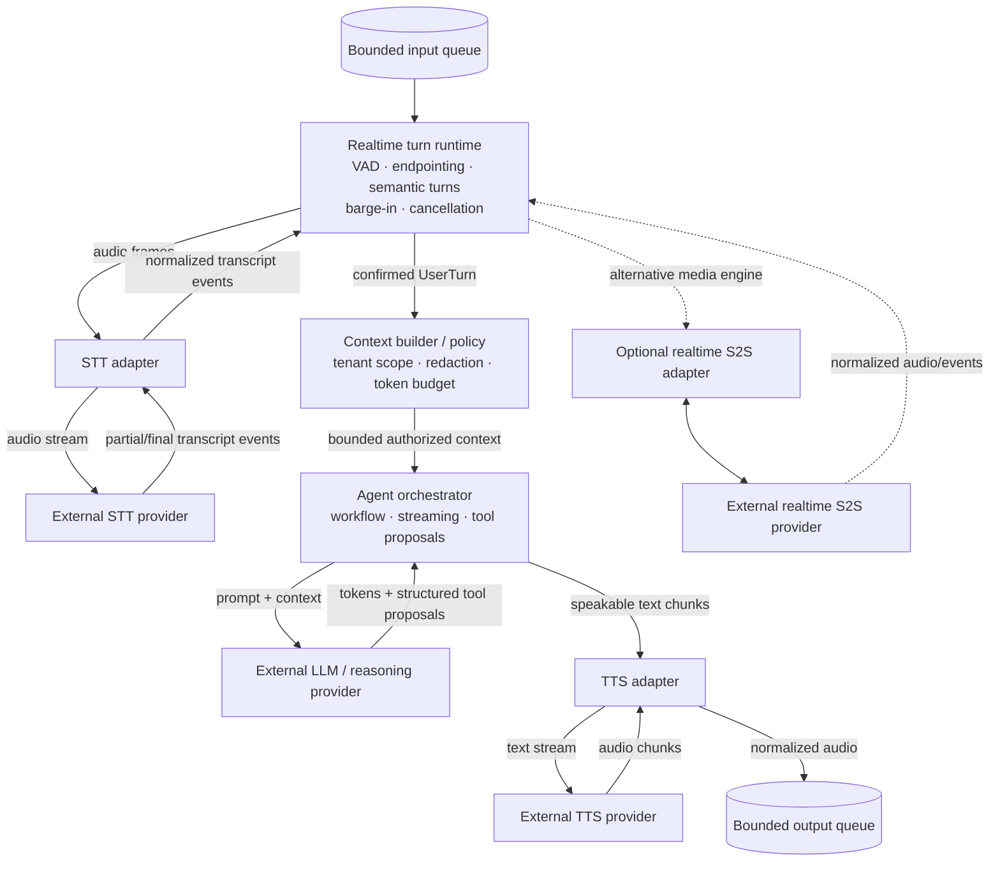
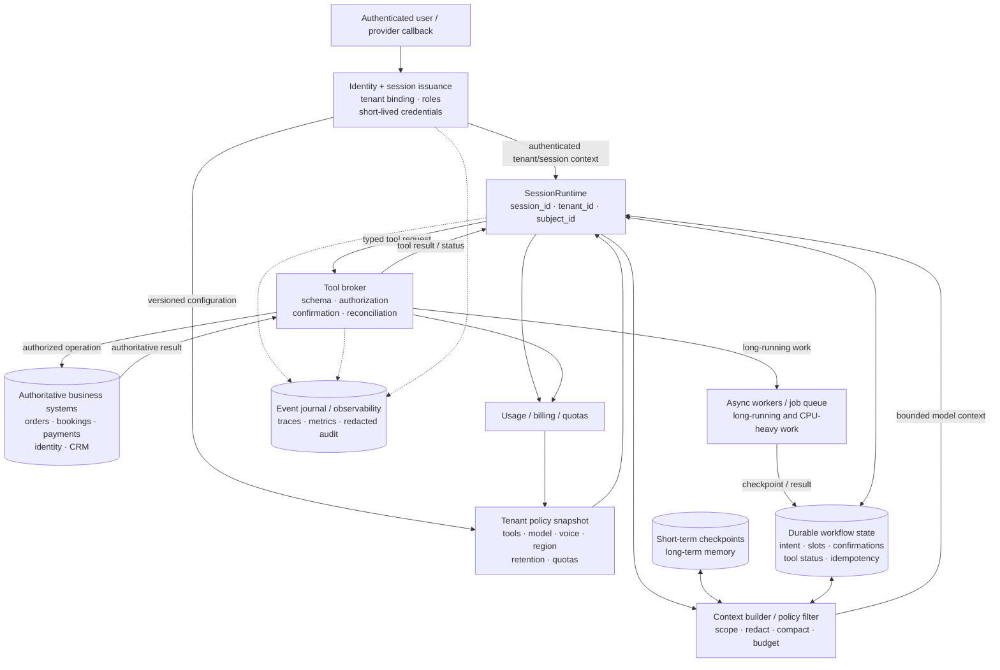

# Voice-agent architecture: print-friendly diagrams

Focused diagrams for the [voice-agent interview preparation guide](./voice-agent-interview.md).
Each diagram is intentionally standalone and can be printed independently.

The architecture uses WebRTC as the primary browser media transport. HTTPS/WSS
is used for authentication and signaling; STT/TTS provider streams are internal
application connections behind provider adapters.

## 1. Media plane

This diagram shows only the time-sensitive media path and its transport
boundaries. The media gateway owns WebRTC details; the session runtime receives
normalized frames and returns normalized output audio.



Key invariant:

```text
WebRTC packets are decoded and normalized at the media boundary.
The runtime never needs to know RTP, DTLS-SRTP, ICE, or Opus packet details.
```

## 2. Session runtime, voice engine, and external providers

This diagram shows the per-session processing path after the media gateway has
produced normalized audio frames. The adapter boxes are application-owned;
provider boxes perform external inference.



The runtime is the session-scoped owner of mutable realtime state. The context
builder decides what the model is allowed to see; the agent orchestrator
coordinates model calls and tool proposals; the TTS adapter converts approved
speakable text into outbound audio.

## 3. Control plane

This diagram shows identity, tenant policy, tools, durable workflow state,
memory, asynchronous work, and observability. These components are authoritative
or durable; they should not be placed on the raw audio hot path unnecessarily.



The control-plane rules are:

- tenant context comes from validated identity, not arbitrary client fields;
- model output is a proposal, not authorization;
- workflow/tool outcomes are persisted with idempotency and uncertainty;
- long-term memory is promoted and retrieved under tenant/subject policy;
- raw audio and sensitive transcripts are redacted and retained deliberately;
- the event journal supports tracing and audit without becoming the business
  source of truth.

## How the three diagrams compose

```text
Media plane
  -> normalized audio/events
  -> SessionRuntime and voice engine
  -> control-plane policy/tools/state
  -> normalized output audio/events
  -> media plane
```

The diagrams are logical boundaries. Depending on scale and provider choice,
the media gateway, session runtime, and adapters may be colocated in one worker,
split into services, or supplied by a managed platform.
