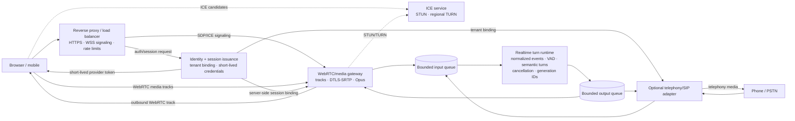
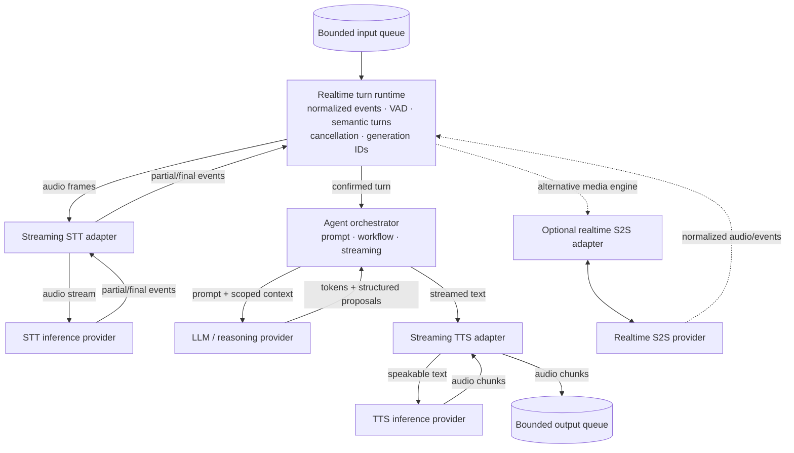
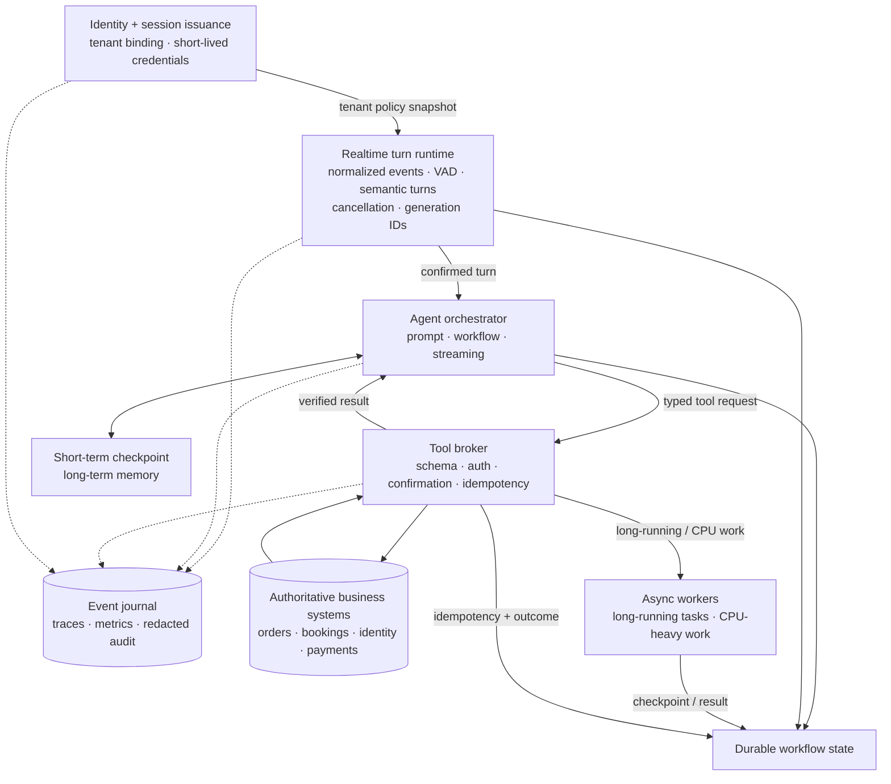

# Voice-agent architecture: print-friendly diagrams

Focused extracts of the canonical architecture in
[voice-agent-architecture-diagrams.md](./voice-agent-architecture-diagrams.md).
The component boxes and labels below are unchanged from the canonical diagram;
only the relevant parts and arrows are extracted for printing.

## 1. Media plane

## 2. Session runtime, voice engine, and external providers

## 3. Control plane

These are logical extracts. Depending on deployment, the canonical components
may be colocated in one worker, split into services, or supplied by a managed
platform; the component contracts and arrows remain the same.
